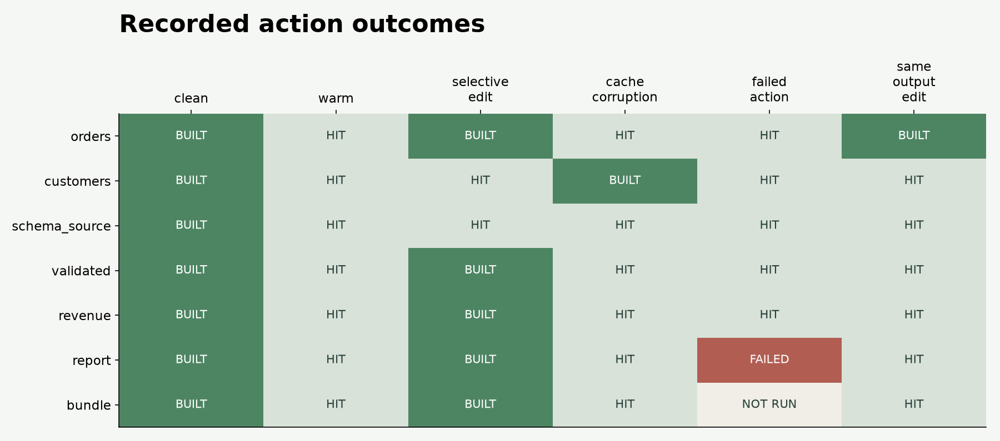

# Content-addressed build lab

**[View the report in your browser](https://Michaelhoang8.github.io/content-addressed-build-lab/)**

A small local build engine that executes a bounded DAG of real file-producing actions. It derives action keys from declared content and tool identity, verifies cached bytes before reuse, runs independent ready actions concurrently and exposes a new release only after the full graph succeeds.



This AI-assisted portfolio exercise uses synthetic orders and customers. It executes owned Python transformations; it does not run arbitrary shell strings, load plugins or contact external services. The recorded durations and artifacts come from actual local execution.

## Inspect the evidence

- [Static report](docs/report.html), [findings](results/findings.md) and [scenario summary](results/summary.csv).
- [Source fixture and seven-action graph](fixture/build.json).
- [Six experiments](results/experiments/), each containing source snapshots, action traces, the selected complete release and pointer evidence.
- [Preserved corrupted cache object](results/rejected_object/) and [before/corrupt/repaired hashes](results/corruption.json).
- [Engine and action keys](buildlab/engine.py), [owned transformations](buildlab/operations.py) and [CLI](buildlab/__main__.py).
- [Key semantics](docs/keys.md), [publication and trust boundaries](docs/publication.md), [experiments and validation](docs/experiments.md).
- [Screenshots](docs/screenshots/README.md) and [continuous report review](docs/recordings/README.md).

## Run a build

The engine and tests use Python's standard library. Python 3.13 is the tested runtime.

```sh
python -m buildlab fixture --cache build/cache --output build/output --trace build/trace.json
```

Repeat the command for a warm-cache build. The selected release is named by `build/output/current.json`, with complete outputs under `build/output/releases/<release>/actions/<action>/`. Releases are copied from verified cache objects; a warm build still verifies bytes and publishes a complete release.

CLI exit codes are 0 for success/help, 1 for a returned action/publication failure, and 2 for expected preflight errors such as invalid graphs, missing files or a locked cache. Expected errors print a short message rather than a traceback.

## Reproduce all six experiments

```sh
python -m unittest discover -s tests -v
python -m pip install -r requirements.txt
python scripts/run_study.py --output-dir build/my-run
python scripts/verify_results.py --output-dir build/my-run
```

The full fixture has 1,200 orders; `--quick` uses 100. The driver runs tests first, creates a fresh local cache, captures each scenario and independently verifies the saved evidence. Omit `--output-dir` to replace committed results. `--reuse` only replots when execution-source hashes match. CI verifies committed evidence and runs an independent quick capture.

The [original measurement driver](results/measurement-sources/run_study.py) and its [recorded hash and commit](results/measurement-sources/manifest.json) are preserved. The current driver adds narrow-screen hash wrapping. This presentation change reused the recorded measurements; `results/source-sha256.json` tracks the current reproducible tool state.

| Scenario | Observed execution |
|---|---|
| Clean | All seven actions produce files. |
| Warm | All seven verified cache objects are reused. |
| Value edit | Five actions in the orders dependency closure rebuild; two remain hits. |
| Cache corruption | Customers rebuilds after rejection; unchanged regenerated bytes preserve downstream keys. |
| Failed action | Report writes a private staged file and raises; the prior release pointer stays byte-identical. |
| Same-output edit | An extra CSV newline rebuilds orders only; normalized output and downstream keys remain unchanged. |

## What makes a key

The canonical key material covers action ID and operation, source names/content hashes/sizes, declared output names, dependency output hashes/sizes, owned argv, JSON configuration and Python/tool source identity. Source modification times are irrelevant. Dependency **output content**, rather than the upstream action key, determines whether downstream work changes.

Column configuration maps are unordered by contract; header membership/count and sorted field parsing keep this behavior consistent with canonical sorted-key hashing. Tests check both a warm cache and a fresh execution after column-map reordering.

## Correctness and limits

Thirteen tests cover key boundaries, dependency closure, concurrent readiness using a barrier, corruption repair, graph/path validation, cache locking, partial-action failure, final-pointer replacement failure, CLI errors and bounded Windows rename retries. Saved outputs are independently checked against every manifest hash and recomputed source-data totals.

The cache is trusted and local. Hash checks detect accidental corruption; a malicious writer could replace both contents and manifest. One build may own a cache at a time, and callers must also ensure one writer per output directory. A crashed process can leave a stale lock requiring inspection and manual removal.

Atomic visibility is not power-loss durability: pointer data is fsynced, but artifact files and directories are not all fsynced. Sources are frozen after per-file reads, not an atomic multi-file filesystem snapshot. Valid cache objects can survive a failed build; failed actions and incomplete whole releases are not selected. There is no remote cache, sandbox for untrusted actions, distributed scheduler, automatic garbage collection or production durability claim.
